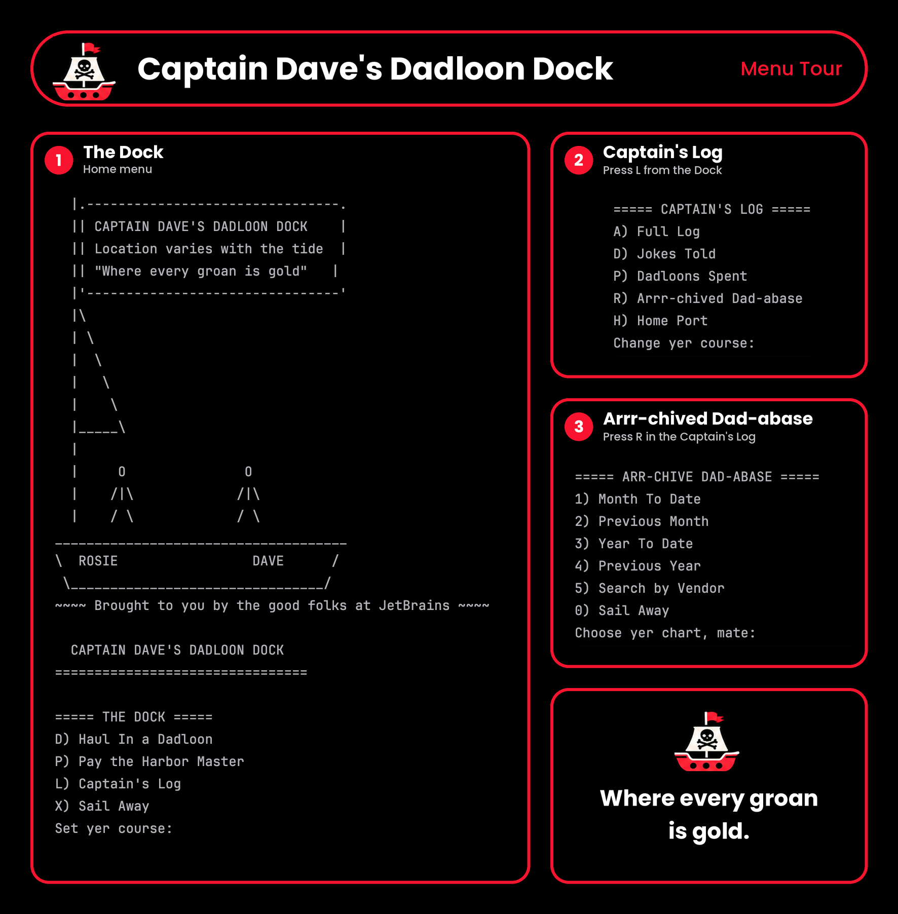
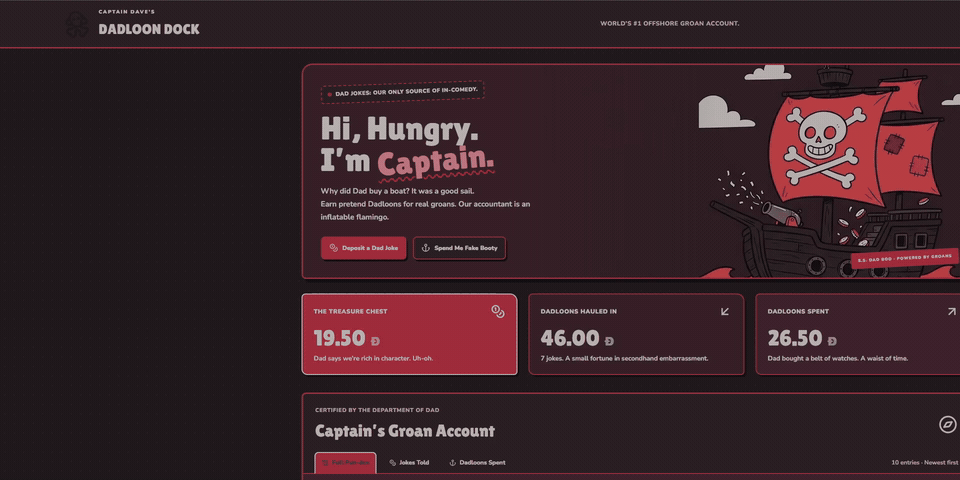
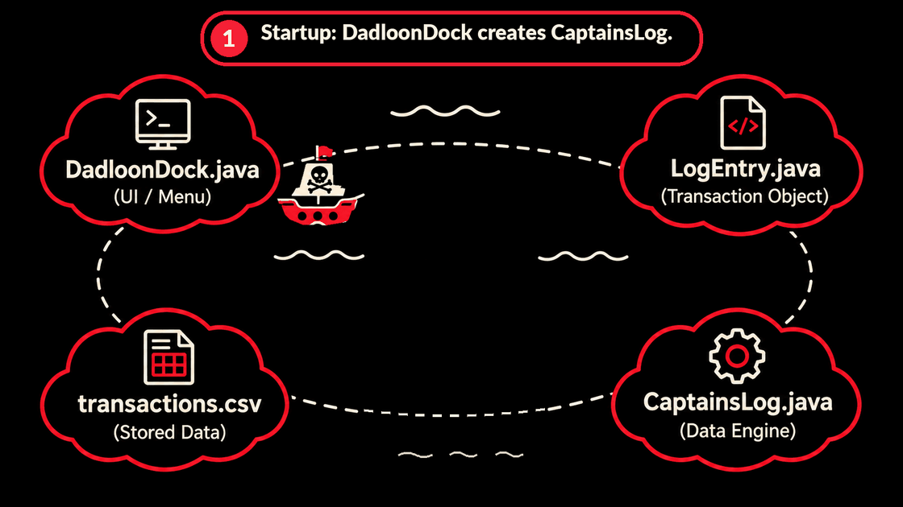

<h1>Captain Dave's Dadloon Dock</h1>
<h2>A Dad Joke "Accounting" Ledger</h2>
<h3><em>"Where every groan is gold."</em></h3>
Hey tired, I'm Dad! Captain Dave's Dadloon Dock is a command-line ledger for tracking <s>financial</s> dad jokes transactions, written in Java 17. 
Dad jokes are the money here. Tell a joke and you earn Dadloons (a deposit). Spend Dadloons on boat stuff (a payment). 
Everything gets saved to a CSV file, so your treasure is still there when you come back.

The whole thing is themed after my instructor Dave, who sails a boat, writes code, and loves dad jokes.
<h2>What It Does</h2>
You can add a deposit (Haul In a Dadloon) or a payment (Pay the Harbor Master) with a date, time, vendor, and description. Type every amount as a positive number. The app turns payments negative for you.

The Captain's Log shows your transactions newest first. You can also look at just the Jokes Told (positive amounts) or just the Dadloons Spent (negative amounts).

The reports menu, which I named the Arrr-chived Dad-abase, has:

Month to date 
Previous month 
Year to date 
Previous year 
Search by vendor

Entries save to <code>transactions.csv</code> as you add them and load again the next time you start the app. Amounts, dates, and times get checked before they're saved, so a typo earns you a pirate scolding instead of a crash.
<h2>Screenshots</h2>
The startup banner (that's me and Dave on the boat):

The Dock, Captain's Log, and Arrr-chived Dad-abase menus:

<h2>What You Need</h2>
Java 17 or higher 
Maven 
IntelliJ IDEA (recommended, and the boat banner gives JetBrains a shout-out)
<h2>Running It</h2>
<strong>1.</strong> Open the project folder in IntelliJ IDEA as a Maven project. 
<strong>2.</strong> Open <code>src/main/java/com/pluralsight/DadloonDock.java</code> and run its <code>main</code> method. 
<strong>3.</strong> Follow the prompts. Talking like a pirate is optional but encouraged.

If you'd rather use a terminal, run these from the project root:

<table align="center"><tr><td><pre><code>mvn compile
java -cp target/classes com.pluralsight.DadloonDock</code></pre></td></tr></table>
Run it from the project root either way. The app looks for its data at <code>src/main/resources/transactions.csv</code>, and that path only works from there.
<h2>How the Code Is Organized</h2><table align="center"><tr><td><pre><code>src/main/java/com/pluralsight/
    DadloonDock.java
    LogEntry.java
    CaptainsLog.java
src/main/resources/
    transactions.csv</code></pre></td></tr></table>
<code>DadloonDock</code> is the entry point and the user interface. It prints the banner and menus and asks for input.

<code>LogEntry</code> is one transaction. It holds the date, time, description, vendor, and amount.

<code>CaptainsLog</code> does the data work. It reads the CSV into memory, saves new entries back to the file, and hands back the lists for each ledger view.
<h2>Data Format</h2>
Transactions are stored in <code>src/main/resources/transactions.csv</code>. Each line is one transaction, with the fields separated by a pipe (<code>|</code>), so keep pipes out of your puns. The first line is a header row:
<table align="center"><tr><td><pre><code>date|time|description|vendor|amount
2026-10-01|09:12:04|Why do Java developers wear glasses? Because they can't C#|Dave|5.00
2026-10-03|18:30:45|I'd tell you a UDP joke, but you might not get it|Dave|3.00
2026-10-06|11:05:20|Marina Berth Fee|Harbor Master|-12.00
2026-10-09|14:22:41|What is a pirate's favorite programming language? It's the C|Dave|8.00
2026-10-11|10:30:00|Spanish Lessons (no return on investment)|Language School|-5.00</code></pre></td></tr></table>
<code>date</code> is <code>YYYY-MM-DD</code> 
<code>time</code> is <code>HH:MM:SS</code> 
<code>description</code> is the joke, or what the payment was for 
<code>vendor</code> is who told the joke, or who got paid 
<code>amount</code> is positive for a deposit and negative for a payment
<h2>Chartin' Our Next main()-euver</h2>

<em>(Next Steps / Updates)</em>
<h3>Groan Levels</h3>
Right now you type in how many Dadloons a joke is worth. Next, I want to replace that with a Groan Level, borrowed from the wind scale sailors use. You'd rate how bad the joke was from 1 to 5, and the worse it is, the more Dadloons it earns: 1, 3, 5, 8, or 12. A level 5 prints <strong>HURRICANE WARNING: NEW SUPPLY MINTED.</strong> 

 SPANGLISH BONUS! A joke told in attempted Spanish gets a +1 Dadloon Spanglish Bonus.
<h3>Web Edition</h3>
There's also a web version: <a href="https://capn-daves-dock.base44.app/">capn-daves-dock.base44.app</a>

It's fully functional, minus a few bugs and unresponsive buttons. You can deposit a dad joke, spend some fake booty, and watch the Treasure Chest balance and the Captain's Groan Account update.
<h3>How the Code Works</h3>
This GIF follows one trip through the code, from startup to saving an entry to printing the ledger.

Animated walkthrough of how DadloonDock, CaptainsLog, LogEntry, and transactions.csv work together.

The same trip as text

1. Startup: <code>DadloonDock</code> creates <code>CaptainsLog</code>. 
2. <code>CaptainsLog</code> calls <code>loadTransactions()</code>. 
3. CSV rows become <code>LogEntry</code> objects in memory. 
4. Startup finishes and <code>DadloonDock</code> shows the menu. 
5. A deposit or payment creates a new <code>LogEntry</code>. 
6. <code>DadloonDock</code> now holds the <code>newEntry</code> object. 
7. <code>DadloonDock</code> calls <code>captainsLog.addEntry(newEntry)</code>. 
8. <code>CaptainsLog</code> adds it to memory and saves the CSV. 
9. <code>saveTransactions()</code> finishes writing the file. 
10. <code>DadloonDock</code> goes back to the menu. 
11. The ledger menu calls <code>getAll()</code> or a filtered getter. 
12. <code>CaptainsLog</code> returns a <code>List</code> of <code>LogEntry</code> objects. 
13. <code>DadloonDock</code> prints the entries.

<h2>Credits</h2>

Built by Rosie, inspired by Captain Dave.

